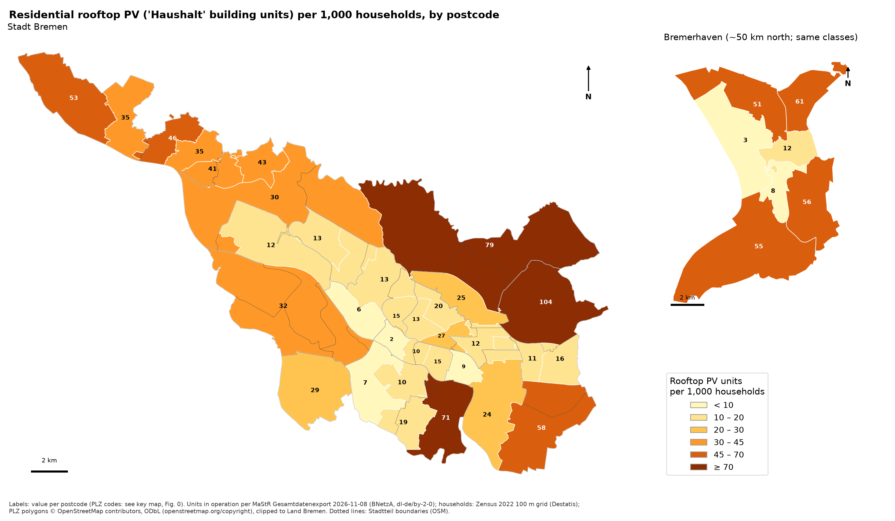

# Bremen's solar map is a map of houses

A study of residential solar equity in the Land Bremen (the city of Bremen and Bremerhaven). It measures rooftop and plug-in ("balcony") photovoltaics (PV) per 1,000 households for each of 40 postcodes and explains the gaps from cited evidence.

**Read the study:** [`report/Bremen_solar_equity_study.pdf`](report/Bremen_solar_equity_study.pdf) (16 pages) · [`report/study.md`](report/study.md) · interactive map: download [`data/bremen_solar_equity_map.html`](data/bremen_solar_equity_map.html) and open it in a browser.

## Main findings

- Rooftop PV ranges from **1.7 systems per 1,000 households in Mitte** (postcode 28195, the city centre) to **104.4 in Oberneuland** (28355, a suburb of detached houses), a 61-fold gap. The household-weighted Gini coefficient is **0.43**.
- The share of dwellings in one- and two-family houses predicts rooftop PV with **ρ = 0.91** and plug-in PV with **ρ = 0.96**.
- The most owner-occupied fifth of households has **8.1 times** the rooftop rate of the most rented fifth. Ranked by income instead, the gap is 2.5 times.
- Comparing houses only, those in richer postcodes have rooftop PV three to four times as often.
- Plug-in PV shows no income effect, but it follows housing type even more closely than rooftop PV. So far it has not become the renters' route to solar.

## Who did the work

The study, from data search to final text, was produced by an AI agent: **Claude Opus 5.5 (Anthropic, model `claude-opus-5-5`), reasoning effort medium**, running in the [Hermes agent](https://hermes-agent.nousresearch.com/docs). The agent:

- did the research and located the data;
- downloaded the data and wrote and ran the GIS and statistics code;
- made the maps;
- wrote the report, then rewrote it to a house style guide.

A **human user** commissioned the work and asked for no credit. Their only inputs were the research brief and the house style guide, both in [`docs/inputs/`](docs/inputs/). They reviewed the result but did not write, edit or correct any part of the analysis or the text.

The repository is meant partly as a dated record of what an AI agent could do unaided in November 2026.

### The workflow

The agent ran three subagents, all on the same model:

- **Subagents A and B** researched in parallel. Each had to save every page it used and return a verbatim quote for every claim. The lead agent re-checked all 140 quotes against the saved pages with a script before citing any of them. None failed.
- **Subagent C** had not seen the drafting. It checked the finished text against the style guide and returned find-and-replace fixes without editing anything. It caught errors the author had missed:
  - the closing example named a postcode from the wrong owner-occupancy fifth;
  - a hedge had been dropped between sections;
  - several terms were used under more than one name.

### Wall-clock time

About 40 minutes passed from the first download to version 1, and 51 minutes to the final version. The times come from file timestamps, not estimates.

Both diagrams were rendered to SVG with [Pele](https://github.com/obsidianmd/pele), Obsidian's Mermaid renderer (v1.13.0), each on its own dark panel so it reads the same in GitHub's light and dark themes. The Mermaid sources are in [`docs/diagrams/`](docs/diagrams/).

### Limits

- The study shows correlation. Section 5 of the report marks each explanation as documented, consistent with other research, or a hypothesis.
- No grid-capacity data by neighbourhood is published, so the study could not test grid capacity as a cause.
- The payback figures rest on the agent's own assumptions for yield and self-consumption. The report labels them as assumptions.
- The style review was done by a subagent of the same model, not by a human.

## Reproduce

Requires Python 3.12 or later. Install with `pip install -r requirements.txt`. The raw downloads are not in the repository: about 3.3 GB from the solar register and 230 MB from the census.

| Step | Script | Input it fetches or needs |
|---|---|---|
| 1 | `scripts/01_zensus_filter.py` | Zensus 2022 100 m grid zips in `raw/zensus/`, from `https://www.destatis.de/static/DE/zensus/gitterdaten/<name>.zip` |
| 2 | `scripts/02_osm_boundaries.py` | Fetches OpenStreetMap boundaries through Overpass |
| 3 | `scripts/03_ortsteilatlas.py` | Bremer Ortsteilatlas files in `raw/ortsteilatlas/`, from `https://www.statistik-bremen.de/tabellen/kleinraum/ortsteilatlas/` |
| 4 | `scripts/04_mastr_extract.py` | The solar register's full export zip in `raw/`, from the [download page](https://www.marktstammdatenregister.de/MaStR/Datendownload); the study used the export of 8 November 2026 |
| 5–10 | `05_…` to `10_…` | Aggregation, analysis, figures, interactive map, validation, economics |

Run the scripts in order from the repository root. A later register export will give somewhat different numbers.

## Evidence

`evidence/ledger.json` lists every cited source with its URL and short verbatim quotes. A script checked each quote word for word against the page text fetched on 10 November 2026. The full page copies stay out of the repository because they are third-party copyrighted material.

`report/to_harvard.py` converts the numbered draft (`report/draft_ledger.md`) into the Harvard version. In a separate pass, it checks that every in-text citation matches the reference list.

## Data sources and attribution

| Data | Source | Licence |
|---|---|---|
| Solar systems | Bundesnetzagentur, Marktstammdatenregister | [dl-de/by-2-0](https://www.govdata.de/dl-de/by-2-0) |
| Census grid and tables | Statistisches Bundesamt (Destatis), Zensus 2022 | [dl-de/by-2-0](https://www.govdata.de/dl-de/by-2-0) |
| Income and SGB II indicators by Ortsteil | Statistisches Landesamt Bremen, Bremer Ortsteilatlas | CC BY (per statistik.bremen.de; version not stated) |
| Postcode, Land and district boundaries | © OpenStreetMap contributors | [ODbL 1.0](https://www.openstreetmap.org/copyright) |
| Basemap of the interactive map | © OpenStreetMap contributors, standard tiles loaded at viewing time | [Tile usage policy](https://operations.osmfoundation.org/policies/tiles/) |

The maps, tables and data files contain changed data and the agent's own calculations. `data/plz_bremen.gpkg` and the postcode tables in `data/` are derived from OpenStreetMap data and are available under the [ODbL 1.0](https://opendatacommons.org/licenses/odbl/1-0/).

## Licence

| What | Licence | File |
|---|---|---|
| Code (`scripts/`, `report/to_harvard.py`) | MIT | [`LICENSE`](LICENSE) |
| Report text, figures and diagrams (`report/`, `figures/`, `docs/`); third-party web pages shown in screenshots keep their own rights | CC BY 4.0 | [`LICENSE-CC-BY-4.0.txt`](LICENSE-CC-BY-4.0.txt) |
| OpenStreetMap-derived data (`data/plz_bremen.gpkg` and the postcode tables in `data/`) | ODbL 1.0 | [`LICENSE-ODbL-1.0.txt`](LICENSE-ODbL-1.0.txt) |

The third-party sources keep their own licences, listed above under *Data sources and attribution*. Credit for reuse: "Bremen solar equity study (2026), produced by Claude Opus 5.5 via the Hermes agent".

Most of this repository was generated by an AI system. Copyright law in the US and in Germany requires a human author, so parts of it may not be protected at all. The licences above state what you may do with it either way.
