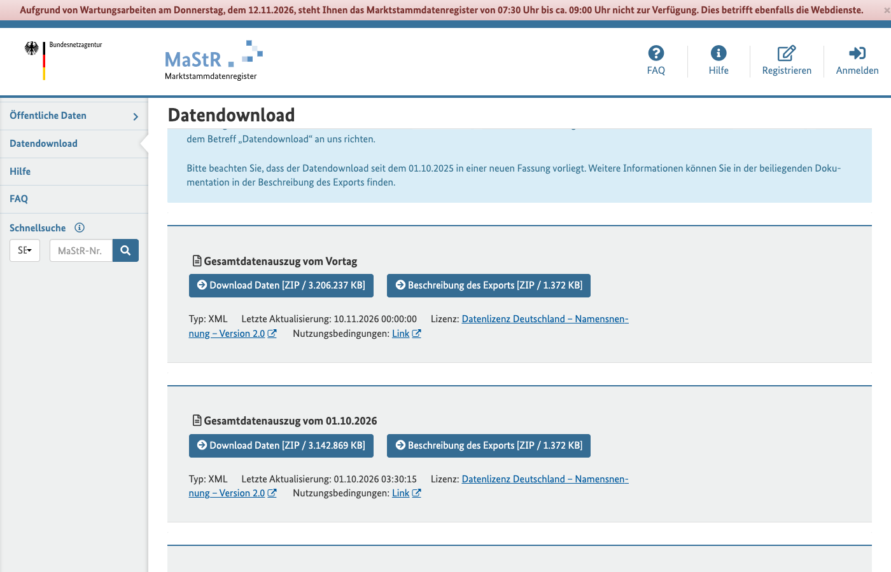
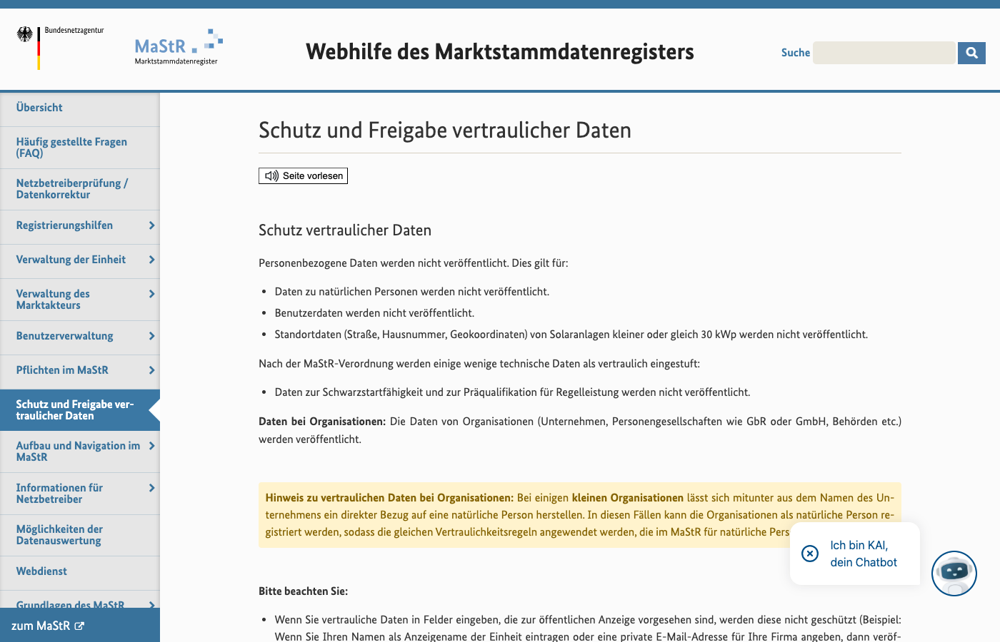
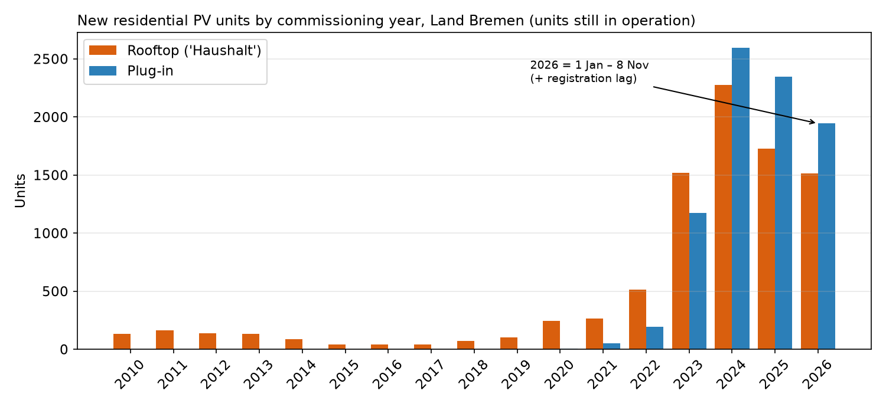
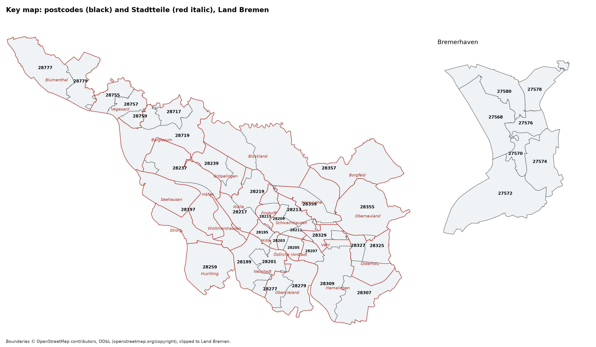
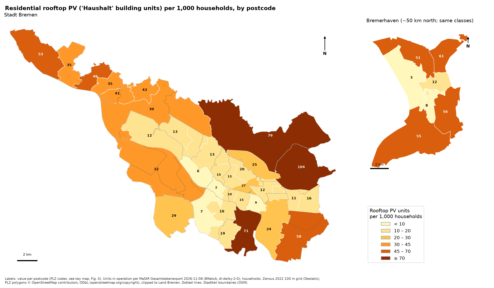
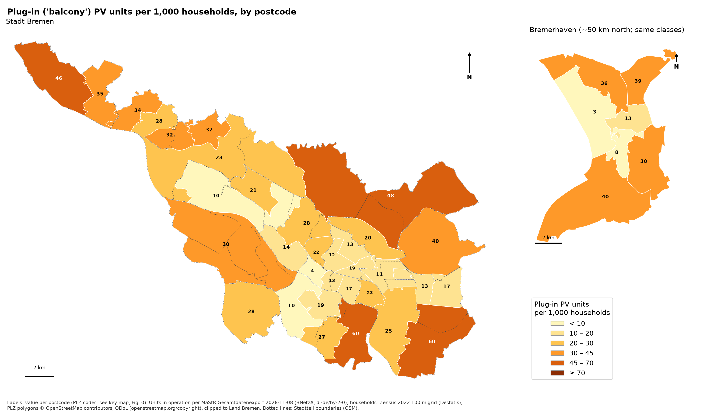
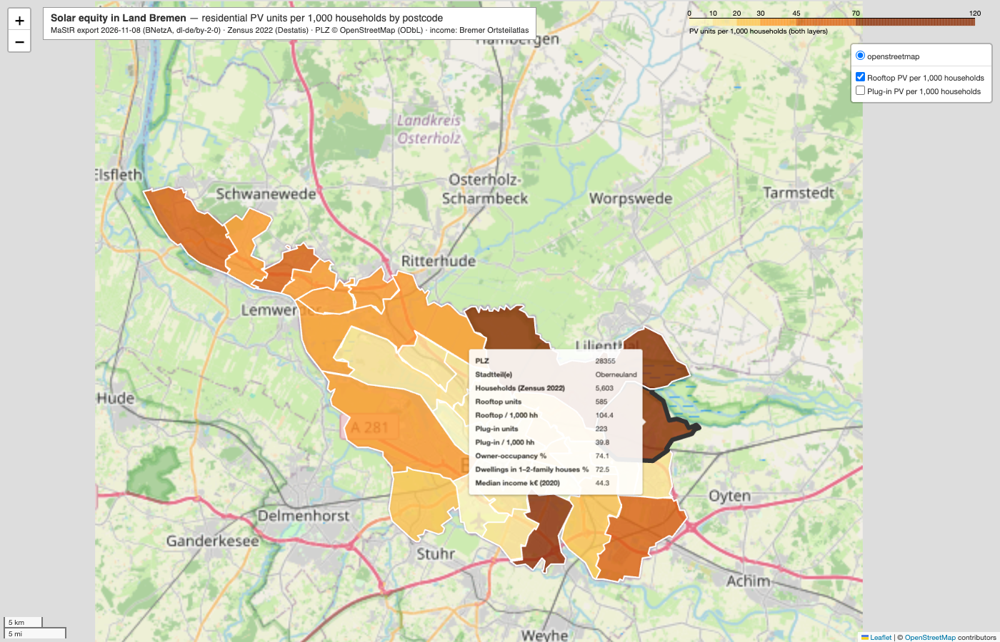
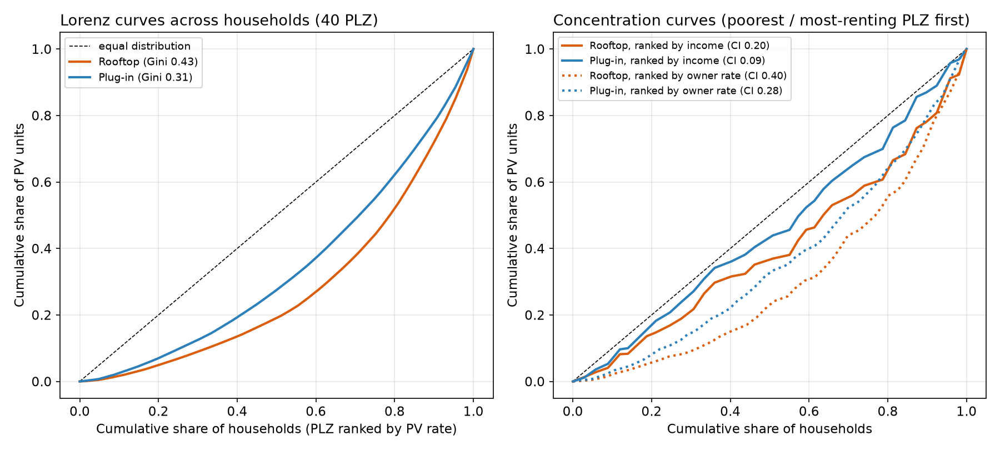
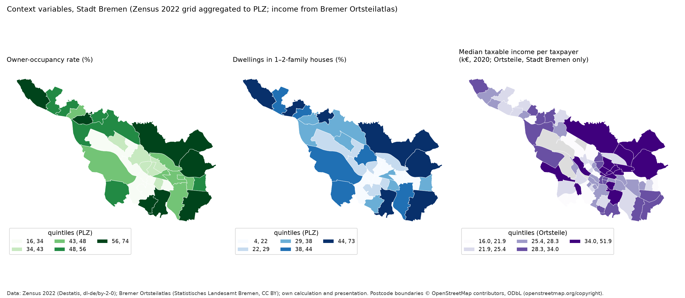
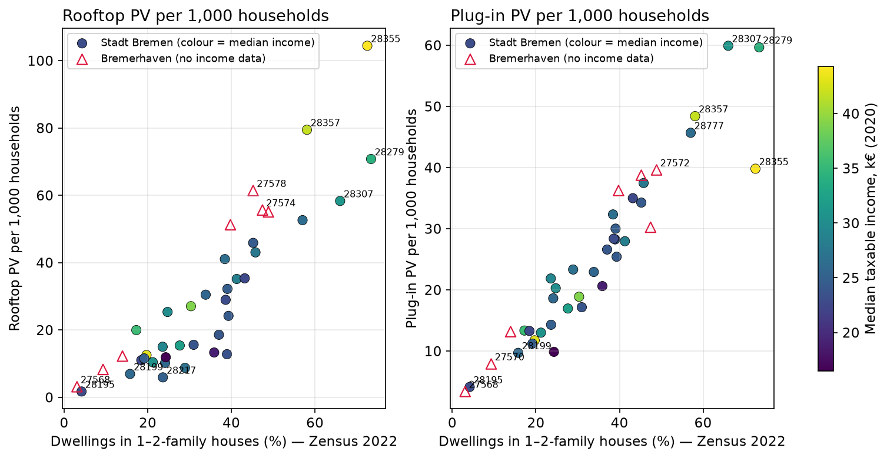

# Bremen's solar map is a map of houses

*Residential rooftop and plug-in photovoltaics (PV) per household, by postcode, in the Land Bremen (the city of Bremen and Bremerhaven), November 2026*

---

**Blunt summary.** Whether a household in Bremen has solar power depends first on whether it lives in a house. Postcodes made up of one- and two-family houses have up to 61 times more rooftop PV per household than the inner-city postcodes of flats. Income works as a second, smaller filter: among houses, those in rich postcodes have rooftop PV three to four times as often as those in poor ones. Plug-in "balcony" PV, the route that federal law now opens to tenants, follows the housing stock even more closely than rooftop PV does. The two legal models for supplying tenants with electricity from their building's roof have barely been used. Bremen's one programme for low-income tenants was voted through by the state parliament in 2022, and the Senate, Bremen's state government, reported in December 2023 that it had not started.

---

## 1. The question and its limits

Housing decides a household's access to solar electricity in Bremen, before income does. This study tests that claim in three steps. Part I sets out what a household faces: the cost, the tax and fee rules, the paperwork, the grid connection and the payback against grid electricity. Part II measures where residential solar actually is, postcode by postcode. Part III explains the gaps from documented evidence and marks every inference that goes beyond it.

The study covers residential access only. It excludes commercial, public, industrial, agricultural and ground-mounted systems. It covers the whole Land, including Bremerhaven, about 50 km north of Bremen. Many Bremen statistics leave Bremerhaven out, even though its owner-occupancy rate is lower: 30.1 % against 37.0 % in the city of Bremen (Statistisches Landesamt Bremen, n.d.-a).

Two terms recur throughout. **Rooftop PV** means a building-mounted PV system registered as serving a household. **Plug-in PV** means a small "balcony" system that plugs into a socket. The two are different products with different buyers, so the study reports them separately.

## 2. Part I: what decides a household's access

### 2.1 The price of entry

A rooftop system costs five figures and a plug-in system costs three. The consumer advice service Verbraucherzentrale Nordrhein-Westfalen analysed 71 real offers made between January 2025 and August 2026 (Verbraucherzentrale, 2026). Its index shows the price per kilowatt-peak (kWp) falling steeply as systems get bigger:

| System size (kWp) | 4–6 | >6–8 | >8–9 | >9–10 | >10–12 | >12–14 | >14–16 | >16 |
|---|---|---|---|---|---|---|---|---|
| Average turnkey price without battery, € per kWp | €2,090 | €1,820 | €1,520 | €1,410 | €1,290 | €1,240 | €1,220 | €1,010 |

*Source: Verbraucherzentrale price index, as of 28 August 2026 (Verbraucherzentrale, 2026).*

The research institute Fraunhofer ISE gives a wider band of €700 to €2,000 per kWp and reports that small systems have become more expensive (Fraunhofer ISE, 2024). A battery adds €360 to €510 per kWh of storage in the Verbraucherzentrale index (Verbraucherzentrale, 2026). A plug-in device with a standard module costs between €200 and €600 (Verbraucherzentrale Schleswig-Holstein, 2026).

The smallest roofs pay the highest price per kWp. That penalty falls on terraced housing, which is the commonest building type in the city of Bremen (section 5.2).

### 2.2 Tax and fees

The federal government removed the main tax costs for small systems from 2023. Supply and installation of PV on or near a dwelling carry no VAT if the system is 30 kWp or smaller (§12(3) UStG), and plug-in devices have also carried no VAT since 1 January 2023 (Verbraucherzentrale Schleswig-Holstein, 2026). Income from building-mounted PV up to 30 kWp per dwelling is exempt from income tax (§3 No. 72 EStG). The law caps the annual cost of a smart meter at €130 for a system of 7 to 15 kW, and at €60 for a meter the household installs voluntarily (§30 MsbG).

Each of these rules lowers the cost of owning PV. None of them helps a household that has no roof to put it on.

### 2.3 Paperwork and the grid connection

A private household cannot register its own rooftop system with the grid operator; only an installer can. The grid operator for both cities is wesernetz, which runs wesernetz Bremen GmbH and wesernetz Bremerhaven GmbH under one management (wesernetz, n.d.-b). Federal law requires grid operators to connect renewable plants without delay and to run a web portal for connection requests (§8 EEG 2023). wesernetz requires an installer to register every rooftop system with it before installation (wesernetz, n.d.-a). The review is free for systems up to 30 kW (wesernetz, n.d.-a). The owner must then enter the system in the federal register of energy plants, the *Marktstammdatenregister* (the register), within one month of switching it on (wesernetz, n.d.-a).

In December 2024 the *Weser-Kurier* reported that wesernetz could connect every new system but could not say when, with some waits longer than six months (Weser-Kurier, 2024).

Federal law treats plug-in PV far more lightly. A plug-in device is a legal category of up to 800 W at the inverter and 2,000 W of modules (Verbraucherzentrale, 2024). Its owner no longer has to notify the grid operator, and registration in the register now asks for five technical details (Verbraucherzentrale, 2023). A tenant can demand the landlord's consent to the changes a plug-in device needs (§554 BGB), and a flat owner has the same right against the owners' association (§20 WEG).

wesernetz contradicts that federal rule on its own website. Its information page for generators, read on 10 November 2026, says plug-in devices "must be registered with the grid operator" (wesernetz, n.d.-d). *Hypothesis, untested here:* outdated instructions do most to deter the households that have no installer to ask.

### 2.4 Feed-in payments and the 2027 bill

A household that installed rooftop PV of up to 10 kW between 1 August and 31 December 2026 receives 7.70 cents for each kilowatt-hour it exports, or 12.22 cents if it exports everything (Bundesnetzagentur, 2026). Since February 2025 the payment falls to zero in hours of negative wholesale prices (§51 EEG 2023), and a system under 25 kW without a smart meter and control box may feed in at most 60 % of its rated power (§9 EEG 2023).

The tariff itself is about to change. The Bundesnetzagentur, the federal grid regulator, notes that the current law runs to 31 December 2026 and that its successor is before parliament (Bundesnetzagentur, 2026). The government's bill (Bundestag document 21/7867) abolishes the fixed tariff for new plants, largely ends support for new plants under 25 kW and exempts plug-in devices up to 2 kW from the new feed-in limits (Bundesregierung, 2026). Plants switched on before 1 January 2027 keep the old terms (Bundesregierung, 2026). The Bundestag, the federal parliament, held the first reading on 24 September 2026, and the Bundesrat, the chamber of the states, opposed ending the rooftop tariff (Deutscher Bundestag, 2026). The trade journal *pv magazine* expected the final vote in November 2026 (pv magazine, 2026). On 10 November 2026 the bill had not passed.

The cut-off has a beneficiary. Households that install before 2027 keep a fixed tariff for 20 years, and Part II shows that those households live mainly in owner-occupied suburbs. A later adopter in a poorer postcode would earn only the value of the electricity it uses itself.

### 2.5 Two legal routes for tenants

German law offers landlords two ways to sell roof electricity to their tenants. Under the tenant-electricity model, *Mieterstrom*, the price may be at most 90 % of the local basic tariff, and the supply contract must be separate from the lease (§42a EnWG). The model attracts a small bonus of 2.51 cents per kWh for systems switched on in late 2026 (Bundesnetzagentur, 2026). The newer shared building supply, introduced by the 2024 solar package, frees the operator from supplying the tenants' remaining demand but requires every participant's consumption to be metered every quarter hour (§42b EnWG). Section 5.5 shows how little either has been used.

### 2.6 Bremen's own instruments

| Instrument | What it does | Status, November 2026 | Who it reaches |
|---|---|---|---|
| Bremen Solar Act (*Bremisches Solargesetz*) | PV on at least 50 % of the roof of new buildings from 1 July 2025; at least 1 kW within two years of a major roof renovation from 1 July 2024 (SUKW, n.d.-a) | In force; roofs under 50 m² exempt, and hardship exemption where financing is impossible (BremSolarG) | Builders and renovating owners |
| Bremer Aufbau-Bank "Rund ums Haus" loan | Annuity loans up to €50,000 for owners (Bremer Aufbau-Bank, n.d.); about 4.3 % interest at launch in 2024 (energiekonsens, n.d.-a) | Active; a loan, not a grant; current rate not checked | Owners with credit |
| Bremerhaven PV grant | 25 % of the cost for private households from January 2023 (energiekonsens, n.d.-a); plug-in devices excluded (Weser-Kurier, 2023) | Ended in the 2024 budget (energiekonsens, n.d.-a) | Owners in Bremerhaven |
| Plug-in pilot for tenants | Parliament asked the Senate in 2022 for a grant for tenants, especially those on benefits (Bremische Bürgerschaft, 2022) | Senate, December 2023: no pilot, no applications (Senat der Freien Hansestadt Bremen, 2023a); an NGO reports it still has not started (Bremer SolidarStrom, n.d.) | Low-income tenants: the only instrument aimed at them |
| Bremer SolidarStrom | An NGO gives plug-in devices to low-income households, partly funded by the Bremer Klimafonds and the environment department (Bremer SolidarStrom, n.d.) | Active, small | Low-income households |
| Free solar advice | Advice from the climate agency energiekonsens, funded by the environment department (energiekonsens, n.d.-b) | Active | Everyone |

The Senate aims for 1,000 MW of PV by 2038 (Senat der Freien Hansestadt Bremen, 2023a). This study found no grant in the Land Bremen that is tied to a household's income.

### 2.7 The grid by neighbourhood

No public source shows how much solar capacity each neighbourhood's grid can take. wesernetz states that there is no congestion in either city's network (wesernetz, n.d.-c). The federal rules for the grid operators' joint platform require them to publish connection procedures, regional scenarios and network expansion plans, but not a capacity map (§14e EnWG). wesernetz's page on that platform links to its connection portal and its expansion plan (VNBdigital, n.d.). Part II therefore cannot test grid capacity as a cause. The one documented friction on the grid side is delay (Weser-Kurier, 2024).

### 2.8 Payback against the grid

Over 20 years rooftop PV beats grid electricity easily; over the first five it is a large debt. The energy industry association BDEW puts the average household electricity price in 2026 at 37.3 cents per kWh (BDEW, 2026). Fraunhofer ISE estimates that small rooftop systems generate electricity at 6 to 14 cents per kWh, that households use 20 to 40 % of their own output without a battery, and that a battery typically doubles that share (Fraunhofer ISE, 2026).

The illustration below uses two assumptions of mine. I assume a yield of 900 kWh per kWp a year, below Fraunhofer ISE's figure of about 1,080 for a new plant facing due south (Fraunhofer ISE, 2026), because Bremen's roofs face every direction. I ignore maintenance, ageing, discounting and lost hours of feed-in. Formula: annual value = generation × self-use share × grid price + generation × (1 − self-use share) × feed-in tariff; payback = cost ÷ annual value (script `10_economics.py`).

**Rooftop PV, 8 kWp at €1,820 per kWp, total €14,560:**

| Scenario | Self-use share | Feed-in tariff | Value per year | Simple payback |
|---|---|---|---|---|
| Base | 30 % | 7.70 c | €1,194 | 12.2 years |
| More self-use (battery or habits) | 40 % | 7.70 c | €1,407 | 10.3 years |
| No tariff, as under the 2027 bill | 30 % | 0 c | €806 | 18.1 years |
| Yield of 800 kWh per kWp | 30 % | 7.70 c | €1,061 | 13.7 years |
| Grid price of 30 c | 30 % | 7.70 c | €1,036 | 14.1 years |

The payback is the same in every postcode, but the outlay is not the same burden. That €14,560 equals 88 % of the median taxable income per taxpayer in Gröpelingen (postcode 28237, €16,500 in 2020) and 33 % in Oberneuland (28355, €44,300). Those ratios are my calculation from the incomes in the *Ortsteilatlas*, the state statistics office's atlas of the city's sub-districts (section 3.2).

**Plug-in PV, an 800 W device at €400 to €600.** With my assumed yields of 500 to 700 kWh per kWp and self-use of 40 to 70 %, a device saves €60 to €146 a year and pays back in 2.7 to 10.1 years. The Verbraucherzentrale Schleswig-Holstein gives one worked example: a 500 W device for €450 "could" pay back in six to eight years (Verbraucherzentrale Schleswig-Holstein, 2026). Plug-in PV is cheap to start, but it covers a small part of a household's demand and earns nothing for exports.

## 3. Part II: method

### 3.1 Choices made before the analysis

| Decision | Choice | Reason |
|---|---|---|
| Spatial unit | Five-digit postcode; 40 postcodes | The register withholds street, house number and coordinates for every solar system of 30 kWp or less (Bundesnetzagentur, n.d.-a) (screenshot 2). The postcode is the finest location it publishes for homes. |
| Outcome | Systems in operation per 1,000 private households; rooftop PV and plug-in PV reported separately | The question is how many households solar reaches |
| Denominator | Private households from the 2022 census, 100 m grid (the census grid) | The only household count below city level that uses one method for both cities (Destatis, n.d.-b) |
| Explanatory variables | From the census grid: owner-occupancy rate, dwellings by building type, building owner type, rent, age, foreign nationals. For the city of Bremen only: median taxable income (2020) and the share of residents on basic income support under the second book of the Social Code, SGB II (2024), per Ortsteil | The census has no income. The state statistics office publishes income and benefit figures for the 88 Ortsteile of the city of Bremen in its Ortsteilatlas (Statistisches Landesamt Bremen, n.d.-b). Bremerhaven publishes no equivalent. |
| Output | Static maps for print and an interactive web map | The static maps go into a document; the web map lets a reader check any postcode |
| Tools | Python 3.14 with geopandas, shapely, lxml, statsmodels and folium | Every number comes from a script and can be rerun |

### 3.2 Data

| Layer | Source | Date | Licence |
|---|---|---|---|
| Solar systems | Bundesnetzagentur, full export of the register (XML; 3.28 GB compressed, 448 files) (Bundesnetzagentur, n.d.-b) | Export of 8 November 2026 | dl-de/by-2-0 |
| Households, housing, owner-occupancy | Destatis, census grid CSV files, 11 topics (Destatis, n.d.-b) | Census day, 15 May 2022 | dl-de/by-2-0 |
| Income, SGB II share, Ortsteil boundaries | Statistisches Landesamt Bremen, Bremer Ortsteilatlas (Statistisches Landesamt Bremen, n.d.-b) | Income 2020; SGB II 31 December 2024 | CC BY (per statistik.bremen.de; version not stated) |
| Postcode boundaries, Land boundary, city districts | OpenStreetMap through the Overpass service | Read 10 November 2026 | ODbL 1.0 |

*Screenshot 1. The Bundesnetzagentur download page of the register. I downloaded and parsed the export of 8 November 2026 in full.*

*Screenshot 2. The register's confidentiality rule: "Standortdaten (Straße, Hausnummer, Geokoordinaten) von Solaranlagen kleiner oder gleich 30 kWp werden nicht veröffentlicht" (street, house number and coordinates of solar systems of 30 kWp or less are not published). Only 3.2 % of solar systems in the Bremen extract carry coordinates.*

The confidentiality rule protects the households that already own solar. It also stops anyone, this study included, from checking street by street who has been left out.

### 3.3 What counts as residential

The register classifies each solar system by type and by the main use of the building it sits on. I fixed both outcome definitions before looking at any postcode figure. Rooftop PV is a building-mounted system (`Gebäudesolaranlage`) on a building whose use is "household" (`Haushalt`) and which is in operation. Plug-in PV is a system of the plug-in type (`Steckerfertige Solaranlage`) in operation.

| Filter step (script `06_analysis.py`) | Systems |
|---|---|
| All solar systems with a municipality code of Bremen or Bremerhaven | 20,300 |
| In operation | 19,438 |
| Building-mounted | 11,118 |
| Of which building use "household": **rooftop PV** | **9,402** |
| Postcode inside the Land boundary | 9,401 |
| Plug-in systems in operation: **plug-in PV** | **8,313** |

The filter removed building-mounted systems on commercial buildings (823), on buildings marked "other" (210), on public buildings (187), in industry (65) and in farming (49), plus 382 with no use recorded. It also removed seven ground-mounted systems.

### 3.4 Spatial processing

I assigned each inhabited 100 m cell of the census grid to the postcode that contains its centre point, after clipping the postcodes to the Land boundary. All 12,662 inhabited cells inside the Land fell into a postcode. I summed counts per postcode and rebuilt rates from the summed counts.

The *Ortsteilatlas* stores its boundaries as compressed pixel paths, not as a map file. I decoded them into 88 *Ortsteil* polygons and compared them with the OpenStreetMap outlines of the city districts. The overlap score (intersection over union) was 0.96 to 0.995 for 21 of 22 districts and 0.74 for the port district. Each census-grid cell takes its *Ortsteil*'s income and SGB II share, and each postcode takes the population-weighted mean of its cells.

The statistics are Spearman rank correlations (40 postcodes; 33 where income exists), least-squares regressions on standardised variables with robust (HC3) standard errors, Gini coefficients and concentration indices weighted by households, and Moran's I for spatial clustering with queen contiguity and 9,999 permutations.

### 3.5 Checks against official figures

| Check | Result |
|---|---|
| Census-grid households against the official census total for the Land (349,406) | 348,170, or 99.65 %; population 99.89 % |
| Census-grid owner-occupancy against the Ortsteilatlas owner-occupancy rate from the same census, 79 Ortsteile | Correlation 0.92; the census-grid figure runs a median 5.2 percentage points higher. **I use it to rank postcodes, not to state levels.** |
| All PV in operation commissioned by the end of 2025, against the environment department's figure of about 188 MW (150 Bremen, 38 Bremerhaven) (SUKW, n.d.-b) | 191.9 MW (153.6 and 38.3) |
| Plug-in systems commissioned by the end of 2025, against the department's "about 6,300 in 2025" (SUKW, n.d.-b) | 6,370 |
| The three postcodes with most systems, against the energiekonsens count of March 2024 (28357: 558, 27578: 425, 28279: 417) (Senatspressestelle, 2024) | Same three, same order; 579, 455 and 416 systems in operation commissioned before 18 March 2024 |
| Other definitions of rooftop PV (30 kWp or less only; any building use up to 30 kWp; including planned systems) | Rank correlation with the main measure of 0.996 to 0.999; same top five and bottom five postcodes |

The register reproduces the official Bremen totals to within 2 %. The postcode ranking does not move when the definition of residential changes at the margin.

### 3.6 Where the method is weak

My choice of outcome understates access in flats. A single rooftop system on a block can supply many flats through *Mieterstrom* or shared supply, yet the register counts it once. Measuring capacity per household instead gives almost the same ranking (rank correlation 0.96) and a Gini of 0.44, so the bias does not reverse the result, but it does exist and it works against the inner city.

The households date from May 2022 and the solar systems from November 2026. Each postcode holds 5,000 to 15,000 households, so differences inside a postcode disappear. Income (2020) and the SGB II share (2024) are *Ortsteil* figures carried onto postcodes. The census suppresses or blurs some small cells for confidentiality, although the totals match the official figures. The building use "household" is whatever the owner entered at registration. Correlations here describe patterns, not causes, and Part III separates the two.

## 4. Part II: results

### 4.1 The totals

| | Households (2022 census) | Rooftop PV systems | Rooftop MWp | Rooftop PV per 1,000 households | Plug-in PV systems | Plug-in PV per 1,000 households | Rooftop W per household |
|---|---|---|---|---|---|---|---|
| **Land Bremen** | 348,170 | 9,401 | 81.7 | **27.0** | 8,313 | **23.9** | 235 |
| City of Bremen (postcodes 28xxx) | 287,808 | 7,557 | 65.3 | 26.3 | 7,044 | 24.5 | 227 |
| Bremerhaven (postcodes 275xx) | 60,362 | 1,844 | 16.4 | 30.5 | 1,269 | 21.0 | 271 |

Rooftop PV holds 36 % of all PV capacity in operation in the Land. The median rooftop system is 7.3 kWp, and 61.9 % are registered with a battery on site. The median plug-in system has 0.86 kWp of modules.

Most of this is new. Three quarters of the rooftop systems and 97 % of the plug-in systems in operation started up in 2023 or later (Fig. 6), the year the VAT exemption took effect.

*Fig. 6. Rooftop PV and plug-in PV still in operation, by year of commissioning. The 2026 bar covers 1 January to 8 November 2026 and will grow as late registrations arrive.*

### 4.2 Where the systems are

*Fig. 0. Key map: postcodes in black, city districts in red.*

*Fig. 1. Rooftop PV per 1,000 households, in fixed classes shared by both cities. Each label is the postcode's value.*

Rooftop PV thins out towards the centre of each city. Every postcode at or near 10 per 1,000 households lies in the dense core of 19th-century and post-war blocks: Mitte (28195), Neustadt (28199, 28201), Walle (28217), Hemelingen (28207) and central Bremerhaven (27568, 27570). Every postcode above 55 lies on the suburban edge: Oberneuland (28355), Horn-Lehe and Borgfeld (28357), Arsten and Habenhausen (28279), Hemelingen and Osterholz (28307), Leherheide (27578), Surheide and Schiffdorferdamm (27574) and Wulsdorf (27572).

Schwachhausen breaks the pattern. Its three postcodes have median incomes of €35,400 to €43,200, among the highest in Bremen, yet they hold only 12 to 27 rooftop systems per 1,000 households.

*Fig. 2. Plug-in PV per 1,000 households, in the same classes as Fig. 1.*

Plug-in PV peaks lower, at 59.9 per 1,000 against 104.4 for rooftop PV, and spreads more evenly across the map's middle value classes. Its geography is the same: low in the cores, high at the edges.

**Rooftop PV per 1,000 households: the five highest and four lowest postcodes** (full table in `out/plz_metrics.csv`)

| Postcode | Main district(s) | Households | Owner-occupancy % | House share % | Median income | Rooftop PV per 1,000 | Plug-in PV per 1,000 | Plug-in share of residential systems % |
|---|---|---|---|---|---|---|---|---|
| 28355 | Oberneuland | 5,603 | 74 | 73 | €44,300 | **104.4** | 39.8 | 28 |
| 28357 | Horn-Lehe, Borgfeld | 9,918 | 61 | 58 | €41,800 | **79.5** | 48.4 | 38 |
| 28279 | Obervieland (Arsten, Habenhausen) | 8,365 | 72 | 73 | €34,200 | **70.8** | 59.7 | 46 |
| 27578 | Leherheide, Lehe (Bremerhaven) | 10,067 | 60 | 45 | n/a | **61.4** | 38.7 | 39 |
| 28307 | Hemelingen, Osterholz | 7,546 | 69 | 66 | €31,200 | **58.3** | 59.9 | 51 |
| 28199 | Neustadt | 12,267 | 22 | 16 | €26,100 | **6.9** | 9.7 | 58 |
| 28217 | Walle | 10,145 | 32 | 24 | €25,000 | **5.9** | 14.3 | 71 |
| 27568 | Mitte, Lehe (Bremerhaven) | 11,216 | 22 | 3 | n/a | **3.1** | 3.4 | 52 |
| 28195 | Mitte | 5,814 | 16 | 4 | €23,000 | **1.7** | 4.1 | 71 |

*House share: the share of dwellings in one- and two-family houses. Owner-occupancy and house share come from the census grid; median taxable income per taxpayer in 2020 comes from the Ortsteilatlas, city of Bremen only.*

*Screenshot 3. The interactive map (`bremen_solar_equity_map.html`). A reader can switch between rooftop PV and plug-in PV and hover over a postcode for its households, systems, owner-occupancy, house share and income.*

### 4.3 How unequal

*Fig. 5. Left: Lorenz curves of systems across households by postcode. Right: concentration curves, with postcodes ranked by income (city of Bremen) or by owner-occupancy (Land).*

| Measure, weighted by households | Rooftop PV | Plug-in PV |
|---|---|---|
| Gini coefficient across 40 postcodes | **0.43** | **0.31** |
| Highest postcode ÷ lowest postcode | 61 | 18 |
| Concentration index, postcodes ranked by owner-occupancy | 0.40 | 0.28 |
| Concentration index, postcodes ranked by income (city of Bremen, 33 postcodes) | 0.20 | 0.09 |

A concentration index of zero would mean that a postcode's rank says nothing about its solar. Ranked by owner-occupancy, rooftop PV is twice as concentrated as it is when ranked by income.

**Households in fifths by their postcode's owner-occupancy rate** (Land Bremen):

| Fifth | Postcodes | Households | Owner-occupancy % | Rooftop PV per 1,000 | Plug-in PV per 1,000 | Rooftop W per household |
|---|---|---|---|---|---|---|
| 1 (most rented) | 6 | 63,513 | 16–27 | **7.4** | 8.8 | 63 |
| 2 | 8 | 75,033 | 31–36 | 12.4 | 16.8 | 112 |
| 3 | 8 | 66,492 | 39–47 | 21.8 | 21.9 | 183 |
| 4 | 8 | 68,731 | 48–54 | 30.8 | 27.3 | 280 |
| 5 (most owner-occupied) | 10 | 74,401 | 55–74 | **59.6** | 42.5 | 509 |
| **Fifth 5 ÷ fifth 1** | | | | **8.1** | **4.8** | 8.1 |

**Households in fifths by their postcode's median income** (city of Bremen):

| Fifth | Postcodes | Median income | Rooftop PV per 1,000 | Plug-in PV per 1,000 |
|---|---|---|---|---|
| 1 (lowest) | 6 | €16,500–23,000 | 19.0 | 20.3 |
| 2 | 6 | €23,600–24,700 | 24.5 | 26.4 |
| 3 | 7 | €24,800–26,500 | 18.0 | 19.2 |
| 4 | 6 | €26,800–30,600 | 20.4 | 22.2 |
| 5 (highest) | 8 | €31,200–44,300 | **48.4** | 34.5 |
| **Fifth 5 ÷ fifth 1** | | | **2.5** | **1.7** |

If solar followed income, the fifths would rise in a staircase. Owner-occupancy produces one; income does not. The bottom four income fifths sit level at 18 to 25 rooftop systems per 1,000 households, and only the richest fifth stands clear. Poor and middle-income Bremen contains both suburban house estates, such as Huchting, Blumenthal and Vegesack, and districts of flats, such as Gröpelingen and Walle, so income alone sorts the map badly.

### 4.4 What the map follows

*Fig. 3. Owner-occupancy and house share from the 2022 census, and median income by Ortsteil from the Ortsteilatlas (2020).*

**Spearman rank correlations** (40 postcodes; income and SGB II, 33; script output `correlations.csv`)

| Postcode characteristic | Rooftop PV per 1,000 households | Plug-in PV per 1,000 households | Rooftop PV per 100 one- and two-family buildings |
|---|---|---|---|
| House share (%) | 0.91\*\*\* | 0.96\*\*\* | 0.50\*\* |
| Owner-occupancy rate (%) | 0.90\*\*\* | 0.86\*\*\* | 0.60\*\*\* |
| Dwellings in blocks of 13 or more flats (%) | −0.43\*\* | −0.52\*\*\* | −0.13 |
| Buildings owned by housing companies, co-operatives or the municipality (%) | −0.43\*\* | −0.49\*\* | −0.31\* |
| Mean age | 0.47\*\* | 0.32\* | 0.58\*\*\* |
| Median income (2020)† | 0.35\* | 0.21 | 0.58\*\*\* |
| SGB II share (% of residents under 65, 2024)† | −0.18 | −0.08 | −0.45\*\* |
| Mean net rent (€ per m²) | −0.26 | −0.23 | −0.25 |
| Foreign nationals (%) | −0.20 | −0.16 | −0.26 |

*\* p < 0.05; \*\* p < 0.01; \*\*\* p < 0.001. † City of Bremen only.*

*Fig. 4. House share against rooftop PV (left) and plug-in PV (right). Colour shows median income; triangles mark Bremerhaven postcodes.*

**Regressions on standardised variables, robust standard errors** (`models.json`)

| Model | Postcodes | Housing coefficient | Income coefficient | R² |
|---|---|---|---|---|
| Rooftop PV ~ house share + income (city of Bremen) | 33 | 0.81\*\*\* | 0.28 (p = 0.010) | 0.88 |
| Rooftop PV ~ owner-occupancy + income (city of Bremen) | 33 | 0.75\*\*\* | 0.32 (p = 0.035) | 0.80 |
| Plug-in PV ~ house share + income (city of Bremen) | 33 | 0.95\*\*\* | −0.02 (p = 0.83) | 0.90 |
| Rooftop PV per 100 one- and two-family buildings ~ income (city of Bremen) | 33 | n/a | 0.64\*\*\* | 0.41 |
| Rooftop PV ~ house share + Bremerhaven indicator (Land) | 40 | 0.92\*\*\* | Bremerhaven +0.23\*\*\* | 0.84 |

House share is the first filter. Once it is known, the regressions account for 88 to 90 % of the differences between postcodes in both rooftop PV and plug-in PV.

Income is the second filter, and it works inside the house stock. Dividing rooftop systems by the number of one- and two-family buildings holds housing roughly constant, and income then explains 41 % of what is left. A house in Oberneuland (15.4 systems per 100 houses) or Horn-Lehe and Borgfeld (13.9) is three to four times as likely to have rooftop PV as a house in Gröpelingen (4.1 and 4.8), Walle (2.8 and 3.7) or Hemelingen's 28207 (3.6). The SGB II share points the same way, with a correlation of −0.45.

Plug-in PV shows no income effect at all, and it follows house share more tightly than rooftop PV does. In the most-rented postcodes it makes up most of the residential solar there is: 71 % of systems in Mitte (28195) and Walle (28217), and 73 % in Hemelingen (28207). The plug-in share of a postcode's systems falls as owner-occupancy rises (rank correlation −0.59, p < 0.001). In absolute terms the most-rented fifth of households still has only 8.8 plug-in systems per 1,000, against 40 to 60 on the suburban edge.

The literature on peer effects predicts that solar clusters in space beyond what housing and income explain. At postcode scale Bremen shows no such clustering: Moran's I is 0.11 for rooftop PV (p = 0.10), 0.13 for plug-in PV (p = 0.09) and 0.12 for the regression residuals (p = 0.11). Section 5.4 discusses what this does and does not rule out.

### 4.5 Bremerhaven against Bremen

Bremerhaven has the lower owner-occupancy rate (Statistisches Landesamt Bremen, n.d.-a) and the higher rate of rooftop PV: 30.5 systems per 1,000 households against 26.3, and still 0.23 standard deviations higher once house share is controlled for. The commissioning years locate the difference (`city_yearly.json`):

| Rooftop PV commissioned per 1,000 households | 2022 | 2023 | 2024 | 2025 | 2026 (to 8 November) |
|---|---|---|---|---|---|
| City of Bremen | 1.4 | 4.2 | 6.1 | **5.2** | 4.4 |
| Bremerhaven | 1.7 | 5.0 | **8.4** | 4.1 | 3.9 |

Bremerhaven's lead comes from 2023 and 2024, the years of its 25 % grant for private PV, which opened in January 2023 and has since ended (energiekonsens, n.d.-a). In 2025 Bremerhaven falls behind Bremen. *This is an inference from timing, not a causal estimate:* Bremerhaven also started from a larger stock before 2023 (9.2 systems per 1,000 households against 6.3). The grant excluded plug-in devices (Weser-Kurier, 2023), and Bremerhaven's plug-in rate is the lower of the two (21.0 against 24.5).

In December 2023 the Senate stated that solar was growing "much faster" in the city of Bremen than in Bremerhaven (Senat der Freien Hansestadt Bremen, 2023b). That statement measured total capacity, commercial systems included. Per household and for homes only, the register shows the reverse for 2023 and 2024.

## 5. Part III: why the gaps exist

I mark each explanation below as **documented** (direct evidence), **consistent** (Bremen matches findings from elsewhere) or **hypothesis** (reasoned, not tested).

### 5.1 Owner-occupancy: documented

The steepest gradient in Bremen runs along owner-occupancy: eight times as much rooftop PV in the most owner-occupied fifth as in the most rented. The American and German research reaches the same conclusion by other routes. The Lawrence Berkeley National Laboratory finds that US rooftop adopters earn 53 % more than the median household, but only 23 % more than the median owner-occupier (Forrester et al., 2024). Owner-occupancy absorbs most of what looks like an income gap. In the US, 97 % of systems on owner-occupied homes in 2023 were on detached houses, and homes occupied by tenants took about 4 % of all installations (Forrester et al., 2024). A German study of household survey data restricts its sample to owners "because only owners can decide", and it drops residents of high-rise buildings, for whom a system of their own is "highly unlikely" (Jacksohn et al., 2018).

Bremen's housing makes this filter harder than the German average. The owner-occupancy rate is 37.0 % in the city of Bremen and 30.1 % in Bremerhaven (Statistisches Landesamt Bremen, n.d.-a), against 44 % for Germany in the same census (Fischer and Henger, 2025). The federal statistics office's household survey puts the Land's owner-occupancy rate at 32.0 % (Destatis, n.d.-a). In the Land, 62.4 % of dwellings are rented, 24.3 % belong to owners' associations, which must vote on any roof installation, and 14.4 % belong to the municipality or its companies (Statistisches Landesamt Bremen, 2024).

### 5.2 Built form: documented in the data

House share predicts solar better than owner-occupancy does, because the owner of a house decides about a roof that no neighbour shares. Bremen built its 19th-century expansion as terraced family houses, the *Bremer Haus*, in place of tenements (WFB Bremen, 2014). As a result, 57 % of the residential buildings in the city of Bremen are terraced: 69,448 of 122,273 (Statistisches Landesamt Bremen, n.d.-a). The Land's climate agency, energiekonsens, contrasts the typical *Bremer Haus* with the large roofs of many blocks of flats (energiekonsens, n.d.-c). The smallest systems cost the most per kWp: €2,090 at 4 to 6 kWp against €1,010 above 16 kWp (Verbraucherzentrale, 2026).

Roof area does not limit the city as a whole. The 2020 solar roof survey found about 10 million m² of well-suited roof in the city of Bremen, enough in theory for about 1,500 MW, while 36 MW was connected (Senatspressestelle, 2020).

*Hypothesis:* small terraced roofs, a high price per kWp and listed-building rules keep prosperous Schwachhausen at 12 to 27 systems per 1,000 households. A test would need roof-level data from the solar roof survey, which this study did not use.

### 5.3 Income and upfront capital: consistent

Poverty in Bremen has an address. About one resident in four in Gröpelingen lives on *Bürgergeld*, the basic income benefit (Arbeitnehmerkammer Bremen, 2025). At the end of 2022 the share of residents under pension age in SGB II households ran from 4.2 % in Oberneuland to 32.9 % in Gröpelingen (Schröder, 2023). The Senate's social monitoring places most high-status *Ortsteile* in the east of the city and the low-status ones in the west (Senat der Freien Hansestadt Bremen, 2025). That is close to the map of rooftop PV in Fig. 1, which is why this study needs a measure that holds housing constant before it can say anything about income.

With housing held constant, richer postcodes still convert houses to solar three to four times as often (section 4.4). Research in Flanders found the same "strong unconditional income effect", working mostly through ownership and suitable houses (De Groote, Pepermans and Verboven, 2016). A German study of household survey data found investment in PV "mainly driven by the economic factors" (Jacksohn et al., 2018).

Part I points to cash, not return, as the mechanism. A €14,560 system pays back in about 12 years in Gröpelingen and in Oberneuland alike, but it costs 88 % of a median taxpayer's annual income in the first and 33 % in the second. Bremen's support does not bridge that difference: its main instrument is a loan for owners with credit (Bremer Aufbau-Bank, n.d.), and no grant depends on income (section 2.6).

The flow of money through the old feed-in system ran the same way. An analysis of German household survey data from 2010 to 2017 found the cost of the renewable surcharge spread "almost evenly", and therefore regressively, while the feed-in payments went increasingly to higher-income owners of PV (Winter and Schlesewsky, 2019). Earlier studies reached the same verdict (Grösche and Schröder, 2014; Neuhoff et al., 2012). In 2012, households at risk of poverty spent on average 5.5 % of their income on electricity (Frondel, Sommer and Vance, 2015).

### 5.4 Peer effects: predicted by the literature, absent at postcode scale

Research elsewhere finds that people install solar when their neighbours have. In Connecticut, one more system within half a mile in the previous year raised later installations measurably (Graziano and Gillingham, 2015). A study of 576,000 German household systems found that "imitative adoption behavior is highly localized" (Rode and Weber, 2016). Sunter and colleagues argue that disadvantaged neighbourhoods in the US stay behind because they lack the first few systems that start the process (Sunter, Castellanos and Kammen, 2019).

Bremen's postcodes show no significant clustering once housing and income are known (section 4.4). *Hypothesis:* the imitation happens street by street and averages out across postcodes of 5,000 to 15,000 households. The register's confidentiality rule for systems of 30 kWp or less (Bundesnetzagentur, n.d.-a) keeps that hypothesis out of reach of public data.

### 5.5 The tenant routes: documented failure

Both tenant routes have failed nationally, not only in Bremen. The federal government's own review in 2019 counted 677 *Mieterstrom* systems with 13.9 MW in total and judged the framework inadequate (Bundesregierung, 2019). By May 2024 the national count was just under 9,000; the economic research institute IW Köln blames the lack of common metering and billing standards across more than 900 grid operators (Breddermann and Henger, 2024). A 2025 analysis for the Ariadne research project found that recent reforms have produced no noticeable increase in PV on blocks of flats (Fischer and Henger, 2025). DIW Berlin, another economic research institute, describes the model as having played "practically no role" (DIW Berlin, 2024).

In Bremen, energiekonsens reports that most *Mieterstrom* providers turn down buildings with fewer than 20 flats and that only one local provider is known (energiekonsens, n.d.-c). It adds that hardly any property manager or owners' association can carry the metering and administration alone (energiekonsens, n.d.-c).

The housing companies that own the roofs in the lowest-solar postcodes have moved slowly. GEWOBA, the city's largest landlord, runs 62 systems with about 2,000 kWp and plans 152 by 2029 (GEWOBA, 2025). In its contribution to a Senate report, GEWOBA states that Bremen's building code bars PV from its high-rise blocks on fire-safety grounds (Senat der Freien Hansestadt Bremen, 2023b). BREBAU, another Bremen housing company, supplies 36 flats from its first *Mieterstrom* project (Green Planet Energy, 2026). The most-rented fifth alone holds about 50,000 renting households.

The one instrument aimed at low-income tenants did not arrive. The state parliament asked for a plug-in grant for tenants on benefits in 2022 (Bremische Bürgerschaft, 2022). In December 2023 the Senate reported no programme and no applications, and it cited budget rules that make a full grant for benefit recipients difficult (Senat der Freien Hansestadt Bremen, 2023a). An NGO, Bremer SolidarStrom, hands out devices on a small scale in its place (Bremer SolidarStrom, n.d.).

The policy framing of plug-in PV as the tenants' route predicts the highest plug-in rates where renting is commonest. Bremen shows the opposite (section 4.4), and the user surveys agree. HTW Berlin found plug-in users to be mostly men over 45 with higher incomes who own their homes; the idea that plug-in PV appeals only to tenants "could not be confirmed" (HTW Berlin, 2022). An earlier survey found 80 % of users were homeowners (Bergner, 2022).

### 5.6 Paperwork: documented friction, size unknown

Three frictions are on record. Only an installer can register rooftop PV with wesernetz (wesernetz, n.d.-a). Connection waits have run beyond six months (Weser-Kurier, 2024). wesernetz's information page still tells households to register plug-in devices with it (wesernetz, n.d.-d). Each costs most for a household without the money or contacts to hand the job to a firm. This study does not measure their effect.

### 5.7 Grid capacity: not testable

wesernetz reports no congestion (wesernetz, n.d.-c), and nobody publishes capacity by neighbourhood (section 2.7). No evidence links grid capacity to the pattern in Part II, and no public data can rule out limits on individual low-voltage lines.

### 5.8 What follows

These are inferences from the findings, not evaluated policies.

A means-tested plug-in grant is the only instrument that reaches the low-income tenants of the most-rented postcodes quickly, now that federal law lets a tenant demand the landlord's consent (§554 BGB). The state parliament voted for such a grant in 2022 and the Senate has not delivered it (Bremische Bürgerschaft, 2022; Senat der Freien Hansestadt Bremen, 2023a).

For the number of households reached, the larger lever in the inner city and central Bremerhaven is the roofs of blocks owned by GEWOBA, BREBAU and owners' associations. What holds those roofs back is metering, administration and the building code (section 5.5), not payback.

If the 2027 bill passes as drafted, new rooftop systems under 25 kW largely lose their feed-in support (Bundesregierung, 2026). In my illustration the payback for a late adopter lengthens from about 12 years to about 18, and the late adopters are disproportionately in the postcodes that are behind today.

Bremen's most-rented postcodes are its postcodes of flats in blocks, and the most-rented fifth has 8.8 plug-in PV systems per 1,000 households. What stops the next household in Neustadt: the landlord, the €400, or the absence of anyone on the same staircase who has done it?

---

## 6. Reproducibility

| Step | Script (`scripts/`) | Output |
|---|---|---|
| Filter the census grid to Bremen | `01_zensus_filter.py` | `work/zensus_*.csv` |
| OpenStreetMap boundaries | `02_osm_boundaries.py` | Postcode, Land and district GeoJSON |
| Ortsteilatlas figures and boundaries | `03_ortsteilatlas.py` | `ortsteile_atlas.gpkg` |
| Extract from the register (6.64 million systems read, 20,300 in Bremen) | `04_mastr_extract.py` | `mastr_solar_bremen.csv` |
| Census grid to postcodes | `05_zensus_aggregate.py` | `plz_zensus.csv` |
| Rates, inequality, correlations, regressions | `06_analysis.py` | `plz_metrics.csv`, `headline.json`, `models.json` |
| Maps, charts, Moran's I | `07_figures.py` | `figures/*.png`, `morans.json` |
| Interactive map | `08_interactive_map.py` | `bremen_solar_equity_map.html` |
| Checks and alternative definitions | `09_validation.py` | `validation.json` |
| Household economics | `10_economics.py` | `economics.json` |

The raw downloads (3.3 GB from the register, 230 MB from the census) are not included in this repository (see README). The text of every web source cited here was saved locally (not published, as it is third-party copyrighted text). A script checked each cited claim's supporting quote word for word against that saved text (`ledger.json`).

## References

- Arbeitnehmerkammer Bremen (2025) *KammerKompakt: Armut und Klima*, February 2025. Available at: https://vahreport.de/images/images_allgemein_25/AKB_KK_6_Seiter_Armut_Klima_final_web_14_02_2025.pdf (Accessed: 10 November 2026).
- BDEW (2026) *BDEW-Strompreisanalyse*, October 2026. Available at: https://www.bdew.de/service/daten-und-grafiken/bdew-strompreisanalyse (Accessed: 10 November 2026).
- Bergner, J. (2022) *Nutzer:innenstudie Steckersolar 2022*. Berlin: HTW Berlin. Available at: https://solar.htw-berlin.de/wp-content/uploads/BERGNER-2022-Nutzungs-Studie-Steckersolar.pdf (Accessed: 10 November 2026).
- Breddermann, C. and Henger, R. (2024) *Großes ungenutztes Potenzial beim Mieterstrom*. IW-Kurzbericht 41/2024. Cologne: Institut der deutschen Wirtschaft. Available at: https://www.iwkoeln.de/fileadmin/user_upload/Studien/Kurzberichte/PDF/2024/IW-Kurzbericht_2024-Mieterstrom.pdf (Accessed: 10 November 2026).
- Bremer Aufbau-Bank (n.d.) *Kredite rund ums Haus*. Available at: https://www.bab-bremen.de/de/page/programm/rund-ums-haus (Accessed: 10 November 2026).
- Bremer SolidarStrom (n.d.) *Solidarische Balkonkraftwerke*. NGO website. Available at: https://bremer-solidarstrom.de/solidarische_balkonkraftwerke (Accessed: 10 November 2026).
- Bremische Bürgerschaft (2022) *Drucksache 20/1418*, 23 March 2022. Available at: https://www.bremische-buergerschaft.de/dokumente/wp20/land/drucksache/D20L1418.pdf (Accessed: 10 November 2026).
- Bundesnetzagentur (2026) *EEG-Förderung und -Fördersätze*. Rates for commissioning 1 August to 31 December 2026. Available at: https://www.bundesnetzagentur.de/DE/Fachthemen/ElektrizitaetundGas/ErneuerbareEnergien/EEG_Foerderung/start.html (Accessed: 10 November 2026).
- Bundesnetzagentur (n.d.-a) *Marktstammdatenregister help: Schutz und Freigabe vertraulicher Daten*. Available at: https://www.marktstammdatenregister.de/MaStRHilfe/subpages/schutzFreigabe.html (Accessed: 10 November 2026).
- Bundesnetzagentur (n.d.-b) *Marktstammdatenregister: Datendownload*. Export of 8 November 2026 used. Available at: https://www.marktstammdatenregister.de/MaStR/Datendownload (Accessed: 10 November 2026).
- Bundesregierung (2019) *Mieterstrombericht nach §99 des EEG 2017*. Bundestag document 19/13430. Available at: https://www.clearingstelle-eeg-kwkg.de/sites/default/files/2020-05/BT-Drs_19-13430_Mieterstrombericht_nach_%C2%A7_99_des_EEG_2017_0.pdf (Accessed: 10 November 2026).
- Bundesregierung (2026) *Entwurf eines Gesetzes zur Änderung des Erneuerbare-Energien-Gesetzes (EEG 2027)*. Bundestag document 21/7867, 7 September 2026. Available at: https://dserver.bundestag.de/btd/21/078/2107867.pdf (Accessed: 10 November 2026).
- De Groote, O., Pepermans, G. and Verboven, F. (2016) 'Heterogeneity in the adoption of photovoltaic systems in Flanders', *Energy Economics*, 59, pp. 45–57 (working-paper version). Available at: https://docs.vlaamsparlement.be/docs/biblio/opendigibib/monografie/2016/343_heterogeneity_in_the_adoption_of_photovoltaic_systems.pdf (Accessed: 10 November 2026).
- Destatis (n.d.-a) *Eigentumsquote nach Bundesländern 2022*. Available at: https://destatis.de/DE/Themen/Gesellschaft-Umwelt/Wohnen/Tabellen/tabelle-eigentumsquote.html (Accessed: 10 November 2026).
- Destatis (n.d.-b) *Zensus 2022: Gitterdaten zum Download*. Available at: https://www.destatis.de/DE/Themen/Gesellschaft-Umwelt/Bevoelkerung/Zensus2022/_publikationen.html (Accessed: 10 November 2026).
- Deutscher Bundestag (2026) *Textarchiv, week 39: Energie, Stromsektor*. First reading, 24 September 2026. Available at: https://www.bundestag.de/dokumente/textarchiv/2026/kw39-de-energie-stromsektor-1211294 (Accessed: 10 November 2026).
- Die Senatorin für Umwelt, Klima und Wissenschaft (SUKW) (n.d.-a) *Bremisches Solargesetz (BremSolarG)*. Available at: https://umwelt.bremen.de/klima/energie/bremisches-solargesetz-bremsolarg-2155612 (Accessed: 10 November 2026).
- Die Senatorin für Umwelt, Klima und Wissenschaft (SUKW) (n.d.-b) *Solarenergie in Bremen*. Available at: https://umwelt.bremen.de/klima/energie/erneuerbare-energien/solarenergie-23704 (Accessed: 10 November 2026).
- DIW Berlin (2024) 'Ausbau der Solarenergie', *DIW Wochenbericht*, 33/2024. Available at: https://www.diw.de/documents/publikationen/73/diw_01.c.911098.de/24-33-1.pdf (Accessed: 10 November 2026).
- energiekonsens (n.d.-a) *Solar-Förderprogramm für private Haushalte in Bremerhaven eingestellt*. Available at: https://energiekonsens.de/aktuelles/solar-foerderprogramm-fuer-private-haushalte-in-bremerhaven-eingestellt (Accessed: 10 November 2026).
- energiekonsens (n.d.-b) *solar-in-bremen.de*. Available at: https://solar-in-bremen.de (Accessed: 10 November 2026).
- energiekonsens (n.d.-c) *PV-Strom für Mehrparteiengebäude: Auf die Plätze, fertig, … los?* Available at: https://energiekonsens.de/aktuelles/pv-strom-fuer-mehrparteiengebaeude-auf-die-plaetze-fertig-los (Accessed: 10 November 2026).
- Fischer, A. and Henger, R. (2025) *Gebäude- und Mieterstrom in Deutschland: Potenziale, Wirtschaftlichkeit und regulatorische Handlungsansätze*. Ariadne-Analyse. Potsdam: Kopernikus-Projekt Ariadne. Available at: https://www.iwkoeln.de/fileadmin/user_upload/Studien/Gutachten/PDF/2025/Ariadne-Analyse-Geb%C3%A4ude-und-Mieterstrom.pdf (Accessed: 10 November 2026).
- Forrester, S., Barbose, G., O'Shaughnessy, E. and Darghouth, N. (2024) *Residential Solar-Adopter Income and Demographic Trends: 2024 Update*. Berkeley: Lawrence Berkeley National Laboratory. Available at: https://eta-publications.lbl.gov/sites/default/files/2024-12/2024_solar-adopter_income_trends_final_v2.pdf (Accessed: 10 November 2026).
- Fraunhofer ISE (2024) *Stromgestehungskosten erneuerbare Energien*. Freiburg: Fraunhofer Institute for Solar Energy Systems, July 2024. Available at: https://www.ise.fraunhofer.de/content/dam/ise/de/documents/publications/studies/DE2024_ISE_Studie_Stromgestehungskosten_Erneuerbare_Energien.pdf (Accessed: 10 November 2026).
- Fraunhofer ISE (2026) *Aktuelle Fakten zur Photovoltaik in Deutschland*, version of 20 August 2026. Available at: https://www.ise.fraunhofer.de/content/dam/ise/de/documents/publications/studies/aktuelle-fakten-zur-photovoltaik-in-deutschland.pdf (Accessed: 10 November 2026).
- Frondel, M., Sommer, S. and Vance, C. (2015) 'The burden of Germany's energy transition: an empirical analysis of distributional effects', *Economic Analysis and Policy*. Available at: https://eldorado.tu-dortmund.de/bitstreams/69a14681-fe88-433a-a339-3c1b7a8d9fcd/download (Accessed: 10 November 2026).
- GEWOBA (2025) *GEWOBA-Vorstand zieht positive Bilanz für 2024*. Press release. Available at: https://www.gewoba.de/presse/mitteilung/gewoba-vorstand-zieht-positive-bilanz-fuer-2024 (Accessed: 10 November 2026).
- Graziano, M. and Gillingham, K. (2015) 'Spatial patterns of solar photovoltaic system adoption: the influence of neighbors and the built environment', *Journal of Economic Geography*, 15(4), pp. 815–839. Available at: https://resources.environment.yale.edu/gillingham/GrazianoGillingham_15_SpatialPatternsPVSystems.pdf (Accessed: 10 November 2026).
- Green Planet Energy (2026) *Mehr Mieterstrom für Bremen*. Press release, 13 February 2026. Available at: https://green-planet-energy.de/presse/artikel/mehr-mieterstrom-fuer-bremen-solarstrom-vom-eigenen-dach-fuer-36-haushalte (Accessed: 10 November 2026).
- Grösche, P. and Schröder, C. (2014) 'On the redistributive effects of Germany's feed-in tariff', *Empirical Economics*, 46, pp. 1339–1383. Available at: https://link.springer.com/article/10.1007/s00181-013-0728-z (Accessed: 10 November 2026).
- HTW Berlin (2022) *Nutzung von Steckersolargeräten 2022*. Berlin: Hochschule für Technik und Wirtschaft Berlin. Available at: https://solar.htw-berlin.de/studien/nutzung-steckersolar-2022 (Accessed: 10 November 2026).
- Jacksohn, A., Grösche, P., Rehdanz, K. and Schröder, C. (2018) *Drivers of renewable technology adoption in the household sector*. SOEPpapers 977. Berlin: DIW Berlin. Available at: http://diw.de/documents/publikationen/73/diw_01.c.596110.de/diw_sp0977.pdf (Accessed: 10 November 2026).
- Neuhoff, K., Bach, S., Diekmann, J. et al. (2012) 'Steigende EEG-Umlage: unerwünschte Verteilungseffekte können vermindert werden', *DIW Wochenbericht*, 41/2012. Available at: https://www.diw.de/documents/publikationen/73/diw_01.c.409391.de/12-41-1.pdf (Accessed: 10 November 2026).
- pv magazine (2026) 'Bundestag wird EEG 2027 und Netzpaket wohl erst im November verabschieden', 15 October 2026. Available at: https://pv-magazine.de/2026/10/15/bundestag-wird-eeg-2027-und-netzpaket-wohl-erst-im-november-verabschieden (Accessed: 10 November 2026).
- Rode, J. and Weber, A. (2016) 'Does localized imitation drive technology adoption? A case study on rooftop photovoltaic systems in Germany', *Journal of Environmental Economics and Management*, 78, pp. 38–48. Available at: https://ideas.repec.org/a/eee/jeeman/v78y2016icp38-48.html (Accessed: 10 November 2026).
- Schröder, P.M. (2023) *Bremer Stadtteile: Personen in SGB-II-Bedarfsgemeinschaften Ende 2022*. Bremen: BIAJ, 9 December 2023. Available at: http://www.biaj.de/images/2023-12-09_personen_in_sgb2-bedarfsgemeinschaften_stadtteile_bremen_ende-2022_biaj-mat-teil-1.pdf (Accessed: 10 November 2026).
- Senat der Freien Hansestadt Bremen (2023a) *Mitteilung des Senats, Drucksache 21/222*, 19 December 2023. Available at: https://www.bremische-buergerschaft.de/dokumente/wp21/land/drucksache/D21L0222.pdf (Accessed: 10 November 2026).
- Senat der Freien Hansestadt Bremen (2023b) *Mitteilung des Senats: Photovoltaik-Ausbau*, 19 December 2023. Available at: https://www.rathaus.bremen.de/sixcms/media.php/13/top%208_20231219_Photovoltaik_Ausbau.pdf (Accessed: 10 November 2026).
- Senat der Freien Hansestadt Bremen (2025) *Sozialmonitoring für das Land Bremen*. Senate paper, November 2025. Available at: https://www.senatspressestelle.bremen.de/sixcms/media.php/13/20251106_Sozialmonitoring_LHB.pdf (Accessed: 10 November 2026).
- Senatspressestelle Bremen (2020) *Grün- und Solardachkataster zeigen Potentiale*. Press release, 7 January 2020. Available at: https://www.senatspressestelle.bremen.de/pressemitteilungen/welches-dach-hilft-im-kampf-gegen-den-klimawandel-gruen-und-solardachkataster-zeigen-potentiale-fuer-dachbegruenung-und-solarnutzung-328858 (Accessed: 10 November 2026).
- Senatspressestelle Bremen (2024) *Über 100 Megawatt Photovoltaik-Leistung im Land Bremen in Betrieb*. Press release, 18 March 2024. Available at: https://www.senatspressestelle.bremen.de/pressemitteilungen/ueber-100-megawatt-photovoltaik-leistung-im-land-bremen-in-betrieb-443538 (Accessed: 10 November 2026).
- Statistisches Landesamt Bremen (2024) *Zensus 2022: Durchschnittliche Nettokaltmiete im Land Bremen bei 7,34 Euro pro Quadratmeter*. Press release, 25 June 2024. Available at: https://www.statistik.bremen.de/publikationen/pressemitteilungen/pressemitteilungen-2024/2024-06-25-zensus-2022-durchschnittliche-nettokaltmiete-im-land-bremen-bei-7-34-euro-pro-quadratmeter-55420 (Accessed: 10 November 2026).
- Statistisches Landesamt Bremen (n.d.-a) *Zensus 2022: Regionaltabelle Gebäude und Wohnungen* (xlsx). Available at: https://www.statistik.bremen.de/sixcms/media.php/13/04_HB_Regionaltabelle_Geb%C3%A4ude_Wohnungen_Z22_final.xlsx (Accessed: 10 November 2026).
- Statistisches Landesamt Bremen (n.d.-b) *Bremer Ortsteilatlas*. Available at: https://www.statistik.bremen.de/datenangebote/bremer-ortsteilatlas-15228 (Accessed: 10 November 2026).
- Sunter, D.A., Castellanos, S. and Kammen, D.M. (2019) 'Disparities in rooftop photovoltaics deployment in the United States by race and ethnicity', *Nature Sustainability*, 2, pp. 71–76. Available at: https://rael.berkeley.edu/wp-content/uploads/2019/01/Sunter-Castellanos-Kammen-Nature-SustainablityDisparitiesPVDeploymentRaceEthnicity.pdf (Accessed: 10 November 2026).
- Verbraucherzentrale (2023) *Gesetze und Normen für Steckersolar: Was gilt, was gilt (noch) nicht?* Updated online. Available at: https://www.verbraucherzentrale.de/wissen/energie/erneuerbare-energien/gesetze-und-normen-fuer-steckersolar-was-gilt-was-gilt-noch-nicht-90740 (Accessed: 10 November 2026).
- Verbraucherzentrale (2024) *Steckersolar: Solarstrom vom Balkon direkt in die Steckdose*. Available at: https://www.verbraucherzentrale.de/wissen/energie/erneuerbare-energien/steckersolar-solarstrom-vom-balkon-direkt-in-die-steckdose-44715 (Accessed: 10 November 2026).
- Verbraucherzentrale (2026) *Was kostet eine Photovoltaikanlage?* Price index compiled by Verbraucherzentrale Nordrhein-Westfalen, as of 28 August 2026. Available at: https://www.verbraucherzentrale.de/wissen/energie/erneuerbare-energien/was-kostet-eine-photovoltaikanlage-49155 (Accessed: 10 November 2026).
- Verbraucherzentrale Schleswig-Holstein (2026) *Balkonkraftwerk: Steckersolar als Alternative fürs Mehrfamilienhaus*. As of 23 July 2026. Available at: https://www.verbraucherzentrale.sh/wissen/energie/balkon-pv-stecker-solar-als-alternative (Accessed: 10 November 2026).
- VNBdigital (n.d.) *wesernetz Bremen GmbH*. Available at: https://vnbdigital.de/vnb/7203 (Accessed: 10 November 2026).
- Weser-Kurier (2023) 'Balkon-Solargeräte sind in Bremen Privatsache', 22 February 2023. Available at: https://www.weser-kurier.de/bremen/wirtschaft/bremen-balkon-solargeraete-sind-in-bremen-privatsache-doc7oxj00dqbpv12zkoqhlg (Accessed: 10 November 2026).
- Weser-Kurier (2024) 'Herausforderungen für PV-Anlagen in Bremen: Netzausbau nötig', 11 December 2024. Available at: https://www.weser-kurier.de/bremen/wirtschaft/herausforderungen-fuer-pv-anlagen-in-bremen-netzausbau-noetig-doc7yf6da2unzqpa2emdjy (Accessed: 10 November 2026).
- wesernetz (n.d.-a) *Anmeldung von Photovoltaikanlagen*. Available at: https://wesernetz.de/fuer-einspeiser/anlagen-anmeldung/anmeldung-pv-anlagen (Accessed: 10 November 2026).
- wesernetz (n.d.-b) *Impressum*. Available at: https://www.wesernetz.de/impressum (Accessed: 10 November 2026).
- wesernetz (n.d.-c) *Strukturdaten des Bremer und Bremerhavener Stromnetzes*. Data as of 31 December 2025. Available at: https://www.wesernetz.de/fuer-partner/energielieferanten/stromnetz/strukturdaten-des-bremer-und-bremerhavener-stromnetzes (Accessed: 10 November 2026).
- wesernetz (n.d.-d) *Informationen für Einspeiser*. Available at: https://www.wesernetz.de/fuer-einspeiser/informationen (Accessed: 10 November 2026).
- WFB Wirtschaftsförderung Bremen (2014) *Typical Bremen: the Bremen house*. Available at: https://wfb-bremen.de/en/page/bremen-invest/bremen-house (Accessed: 10 November 2026).
- Winter, S. and Schlesewsky, L. (2019) 'The German feed-in tariff revisited: an empirical investigation on its distributional effects', *Energy Policy*, 132, pp. 344–356. Available at: https://www.diw.de/de/diw_01.c.797079.de/s_11964.html (Accessed: 10 November 2026).

### Legislation

- Bremisches Solargesetz (BremSolarG), version of 29 May 2024. Available at: https://www.transparenz.bremen.de/sixcms/detail.php?gsid=bremen203.c.236059.de&template=00_html_to_pdf_d (Accessed: 10 November 2026).
- Bürgerliches Gesetzbuch (BGB), §554. Available at: https://www.gesetze-im-internet.de/bgb/__554.html (Accessed: 10 November 2026).
- Einkommensteuergesetz (EStG), §3. Available at: https://www.gesetze-im-internet.de/estg/__3.html (Accessed: 10 November 2026).
- Energiewirtschaftsgesetz (EnWG), §14e. Available at: https://www.gesetze-im-internet.de/enwg_2005/__14e.html (Accessed: 10 November 2026).
- Energiewirtschaftsgesetz (EnWG), §42a. Available at: https://www.gesetze-im-internet.de/enwg_2005/__42a.html (Accessed: 10 November 2026).
- Energiewirtschaftsgesetz (EnWG), §42b. Available at: https://www.gesetze-im-internet.de/enwg_2005/__42b.html (Accessed: 10 November 2026).
- Erneuerbare-Energien-Gesetz (EEG 2023), §51. Available at: https://www.gesetze-im-internet.de/eeg_2014/__51.html (Accessed: 10 November 2026).
- Erneuerbare-Energien-Gesetz (EEG 2023), §8. Available at: https://www.gesetze-im-internet.de/eeg_2014/__8.html (Accessed: 10 November 2026).
- Erneuerbare-Energien-Gesetz (EEG 2023), §9. Available at: https://www.gesetze-im-internet.de/eeg_2014/__9.html (Accessed: 10 November 2026).
- Messstellenbetriebsgesetz (MsbG), §30. Available at: https://www.gesetze-im-internet.de/messbg/__30.html (Accessed: 10 November 2026).
- Umsatzsteuergesetz (UStG), §12. Available at: https://www.gesetze-im-internet.de/ustg_1980/__12.html (Accessed: 10 November 2026).
- Wohnungseigentumsgesetz (WEG), §20. Available at: https://www.gesetze-im-internet.de/woeigg/__20.html (Accessed: 10 November 2026).
